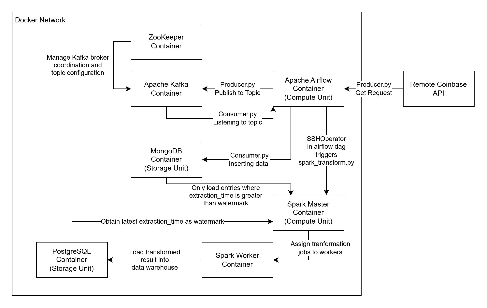

# 🚀 How to Run the Platform (3-Step Quickstart)

Clone the repository, open your terminal inside the project directory, and run the following three commands:

## Spin up the infrastructure cluster
```bash
docker-compose up
```

## Option 1: Manually trigger the automated Spark batch transformation pipeline
```bash
docker exec -it de_airflow airflow dags trigger crypto_batch_transformation_pipeline
```

## Option 2: Login to airflow web UI to trigger the automated Spark batch transformation pipeline

### Step 1: Get the username and password
#### Using Linux
```bash
docker logs de_airflow 2>&1 | grep "password"
```
#### Using Windows
```powershell
docker logs de_airflow 2>&1 | Select-String "password"
```
### Step 2: Open a webbrowser and enter the follow URL

http://localhost:8082/


## Below is a look at the entire architecture



